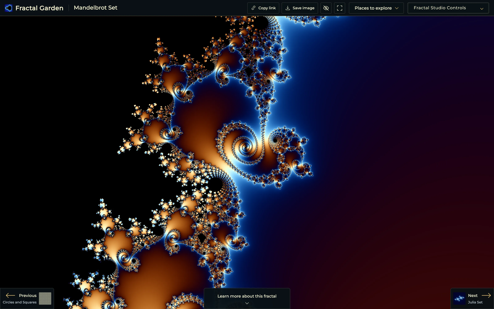
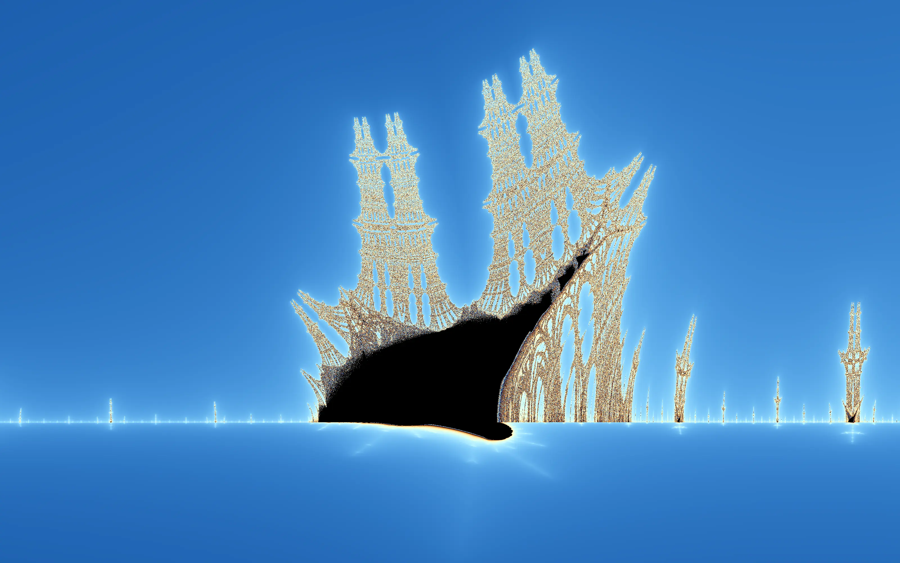
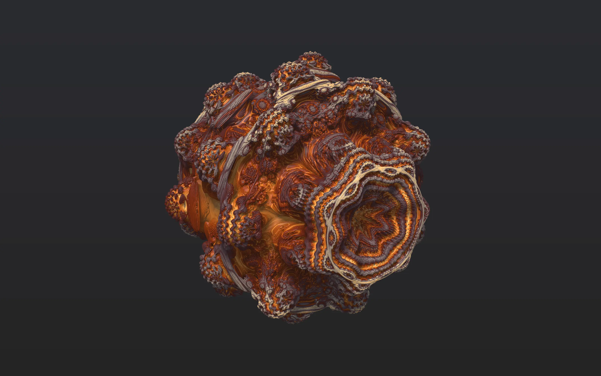
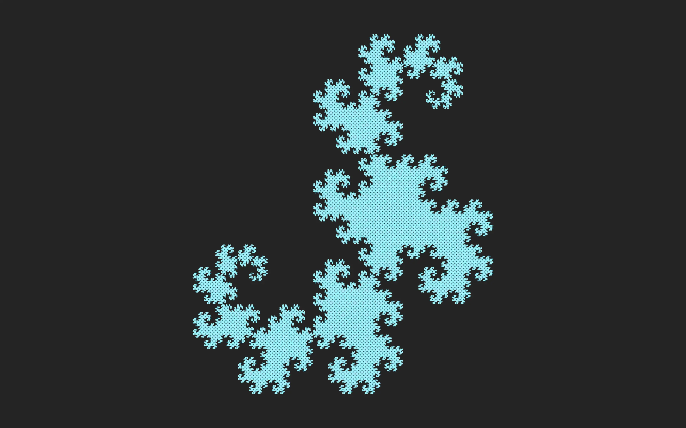
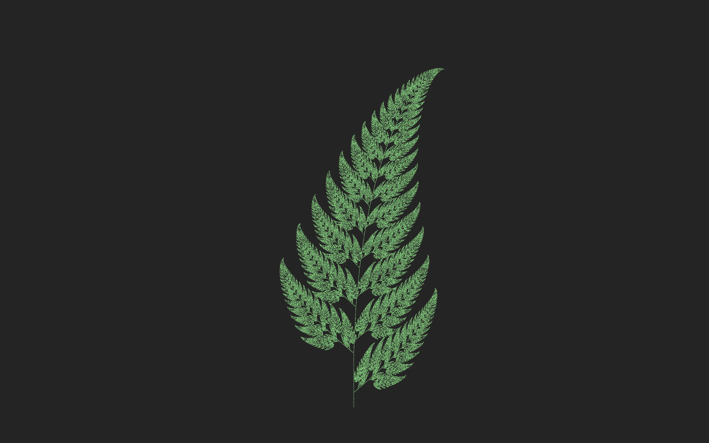
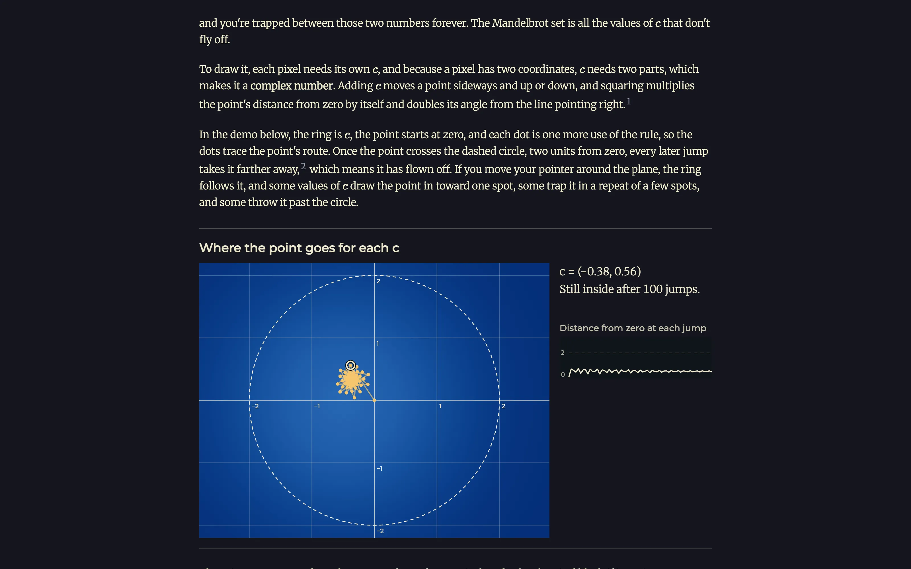
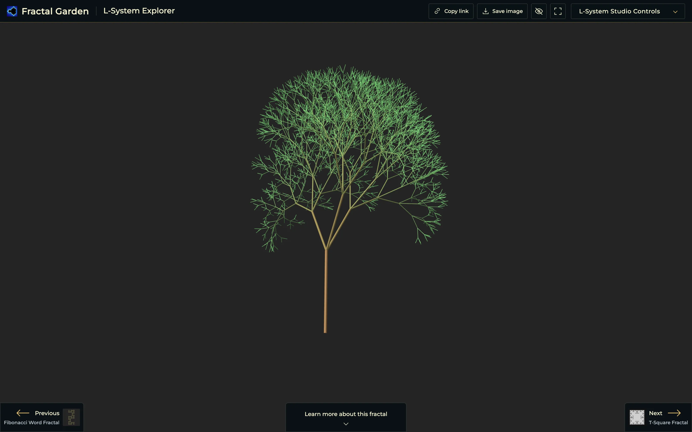

# Fractal Garden

[](https://github.com/trebeljahr/fractal-garden/actions/workflows/deploy.yml)
[](LICENSE)

A picture of the Mandelbrot set shows one view that someone else picked. Fractal Garden gives you 62 fractals to zoom into and change yourself, live in your browser.

Find Seahorse Valley in the Mandelbrot set, fly through a Menger sponge, or write your own L-system rules and watch the curve redraw. Under each fractal, an article explains how the shape is built, step by step, with demos you can try.

It runs at **[fractal.garden](https://fractal.garden)**. There is nothing to install, no account and no ads.



<table>
  <tr>
    <td width="33%"><a href="https://fractal.garden/mandelbrot"></a><br>Mandelbrot set, Seahorse Valley</td>
    <td width="33%"><a href="https://fractal.garden/julia-set"></a><br>Julia set, Sea spiral</td>
    <td width="33%"><a href="https://fractal.garden/burning-ship"></a><br>Burning Ship, Little ship</td>
  </tr>
  <tr>
    <td width="33%"><a href="https://fractal.garden/mandelbulb"></a><br>Mandelbulb</td>
    <td width="33%"><a href="https://fractal.garden/l-system/dragon-curve"></a><br>Dragon curve</td>
    <td width="33%"><a href="https://fractal.garden/barnsley-fern"></a><br>Barnsley fern</td>
  </tr>
</table>

## What you can do

- **Zoom and pan** on every fractal. The Mandelbrot set, Julia set, Burning Ship and several others have a **Places to explore** menu with named views, such as Seahorse Valley or Little ship.
- **Turn the 3D fractals**, such as the Mandelbulb, and fly through the Menger sponge, the Sierpinski tetrahedron and other solid ones.
- **Change each fractal** in the **Fractal Studio Controls** panel, for example its number of steps or its colours.
- **Share the exact view.** **Copy link** puts the view and its settings in the URL. **Save image** downloads the picture as a PNG.
- **Read how it works.** **Learn more about this fractal** scrolls down to the article. It builds the shape one step at a time, with interactive demos. Most articles also list their sources.
- **Write your own L-systems** in the [L-System Explorer](https://fractal.garden/l-system/explorer), in 2D or 3D. **Submit as preset** opens GitHub with the preset file filled in, ready to send as a pull request.

<table>
  <tr>
    <td width="50%"><br>The article under the Mandelbrot explorer</td>
    <td width="50%"><br>The L-System Explorer</td>
  </tr>
</table>

## Run it locally

You need Node.js 24 and pnpm 10.

```bash
git clone https://github.com/trebeljahr/fractal-garden.git
cd fractal-garden
pnpm install
pnpm dev
```

The dev server runs on http://localhost:1111. The site is fully static, so it needs no environment variables. `pnpm build` writes it to `out/`.

| Command | What it does |
| --- | --- |
| `pnpm lint` | Lints the code with Biome |
| `pnpm validate:presets` | Checks the L-system preset files (the build runs it too) |
| `pnpm check:links` | Finds outside links in the articles that no longer load |
| `pnpm test:garden` | Runs the geometry, growth, projection and storage checks for the experimental garden |
| `pnpm test:wheel` | Runs the mouse-wheel zoom tests |
| `pnpm og:images` | Rebuilds the link-preview card in `public/assets/og/` |
| `pnpm marketing:screenshots` | Captures the screenshots in [`docs/marketing/`](docs/marketing/) from `out/` |

### Experimental garden

Open `/garden` on the development server, or use the experimental garden link on the home page.
Compose L-system trees, ferns and shrubs alongside phyllotaxis rosettes in 2D or 3D.
The inspector edits each plant; drag to orbit or arrange the bed. Gardens save in local browser storage.

This page exists only in development. Production builds return `notFound`, omit the home link and exclude the route from the sitemap.
The garden explorer import is also removed from production bundles.
Run `pnpm test:garden` for geometry, growth, projection and storage checks.

## Project structure

```text
pages/                  One page per fractal; L-system pages are in pages/l-system/
fractal-descriptions/   The article under each fractal, in Markdown
components/             Explorers, controls, lessons and demos
utils/                  Renderers, places to explore, share links, page metadata
workers/                Web workers for the heavy drawing work
lsystem-presets/        Presets for the L-System Explorer, one JSON file each
public/assets/          Home-grid pictures, article images, fonts, link-preview cards
scripts/                Build steps, checks and image generators
tests/                  Node tests for the renderers and lessons
docs/marketing/         Screenshots and social preview cards
```

## Tech stack

- Next.js 15 (pages router) with a static export, React 18 and TypeScript
- WebGL and GLSL shaders for the escape-time and 3D fractals, Canvas 2D and web workers for the others
- Markdown articles rendered with react-markdown, with KaTeX for the maths
- Biome for linting and formatting
- Hosted as static files on Cloudflare. [`deploy.yml`](.github/workflows/deploy.yml) builds and deploys on every push to `main`.

## Contributing

Fixes to the articles, new L-system presets and new fractals are welcome. [CONTRIBUTING.md](CONTRIBUTING.md) explains each one. Open issues are labelled [improve-existing-fractals](https://github.com/trebeljahr/fractal-garden/issues?q=is%3Aissue+is%3Aopen+label%3Aimprove-existing-fractals) and [new-fractal](https://github.com/trebeljahr/fractal-garden/issues?q=is%3Aissue+is%3Aopen+label%3Anew-fractal).

## About

Fractals are awesome. They look beautiful and have intricate mathematical connections between each other. And they are simply a lot of fun to play around with. 

This project tries to bring cool fractals to more people. Showcasing the artistic beauty as well as the various connections between them. 
Check out the live version at [fractal.garden](https://fractal.garden)!

### Open Source

The long term plan for this project is to be open source so that people can add more and more beautiful fractals to the mix. I want everybody to "grow" their own little piece of the garden. So that in the end there is a beautiful and detailed overview for the world of fractals - complete with Recursive, WebGL or Lindenmayer implementations for most, if not all, of the fractals out there. 

The Fractal Garden should allow easy exploration, and showcase the connections between the different fractals. It shouldn't be too Mathematics heavy.  Instead it should be rather beautiful and a little whimsical sometimes. There's still a lot of fractals missing and a lot of things to improve. You can have a look at the [issues page](https://github.com/trebeljahr/fractal-garden/issues) and see if you can help out. I am very happy to accept PR's.

### Plug

The Fractal Garden originated as one of my [1-month projects](https://ricos.site/1-month-projects). I hope to tackle more cool projects like it in the future, the idea is to limit the amount of work that I put into each one of them to exactly 1 month and see/document how far I can get. 

## License

The code is under the [MIT License](LICENSE). The Merriweather and Montserrat font files in `public/assets/fonts/` are under the SIL Open Font License 1.1.

## Support

Fractal Garden is free. If you want to support the work, you can donate at [ricos.site/donate](https://ricos.site/donate).
